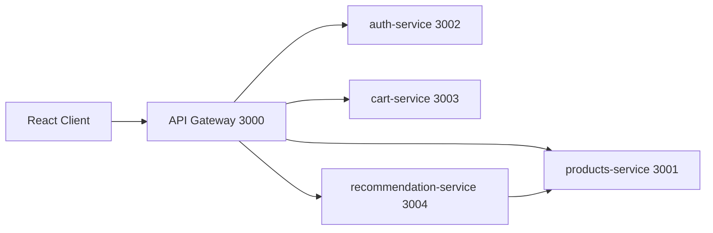

# E-CRF Microservicos

Projeto academico da disciplina de Engenharia de Software refatorado para arquitetura de microservicos, mantendo funcionalidades de catalogo, detalhes, recomendacoes, carrinho, autenticacao simulada e checkout.

## Arquitetura

## Tabela de servicos

| Servico | Porta | Linguagem | Dados |
|---|---:|---|---|
| api-gateway | 3000 | Node.js + Express | Nao persiste |
| products-service | 3001 | Node.js + Express | JSON local |
| auth-service | 3002 | Node.js + Express | JSON local |
| cart-service | 3003 | Node.js + Express | JSON local |
| recommendation-service | 3004 | Node.js + Express | HTTP para products-service |
| client | 3005 local | React | Consome gateway |

## Como executar sem Docker

1. Instalar dependencias:

npm install
npm run install:all

2. Subir tudo:

npm run dev:all

3. URLs locais:
- frontend: http://localhost:3005
- gateway: http://localhost:3000

## Como executar com Docker

1. Subir stack:

docker compose up --build

2. URLs locais:
- frontend: http://localhost:3005
- gateway: http://localhost:3000

## Exemplos de teste com curl

products-service:
- curl http://localhost:3001/health
- curl http://localhost:3001/products

auth-service:
- curl http://localhost:3002/health
- curl -X POST http://localhost:3002/auth/login -H "Content-Type: application/json" -d '{"email":"user@email.com","password":"123"}'

cart-service:
- curl http://localhost:3003/health
- curl http://localhost:3003/cart -H "x-user-id: guest"

recommendation-service:
- curl http://localhost:3004/health
- curl "http://localhost:3004/recommendations/1?viewed=2,3&cart=4,5&limit=4"

gateway:
- curl http://localhost:3000/health
- curl http://localhost:3000/api/status
- curl http://localhost:3000/api/products

## Testes smoke

npm run test:smoke

## Documentacao adicional

- docs/arquitetura.md
- services/api-gateway/README.md
- services/products-service/README.md
- services/auth-service/README.md
- services/cart-service/README.md
- services/recommendation-service/README.md
